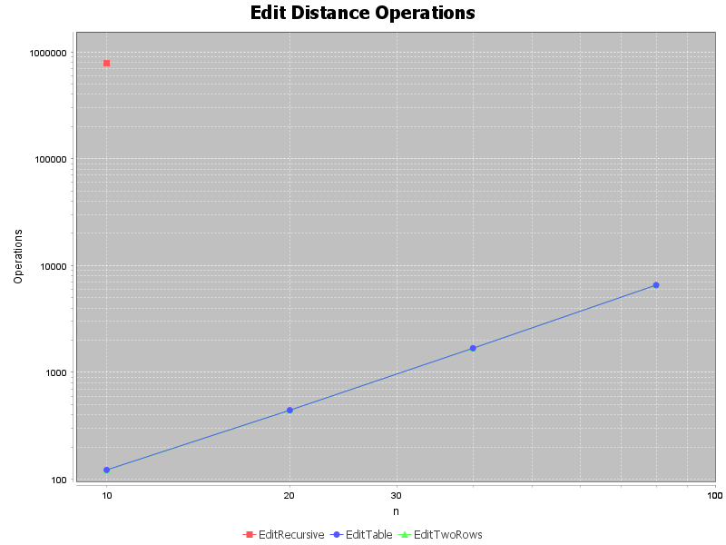
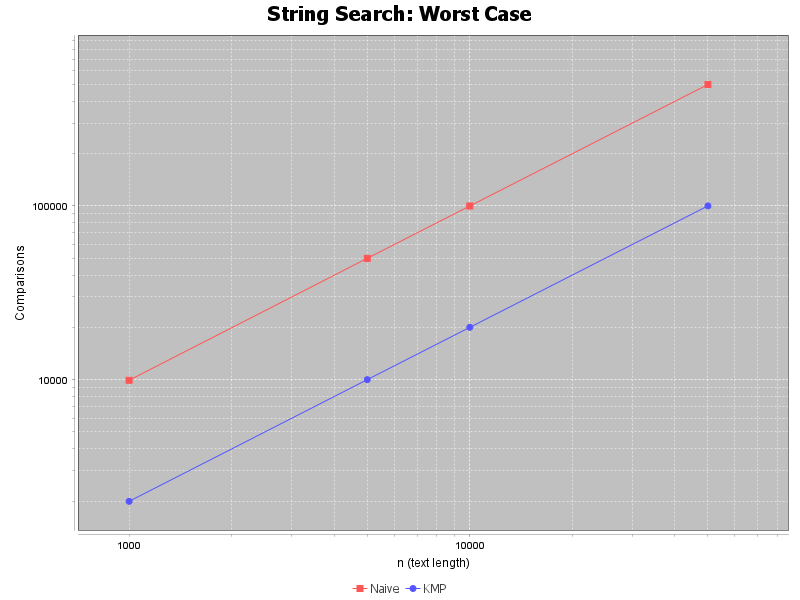
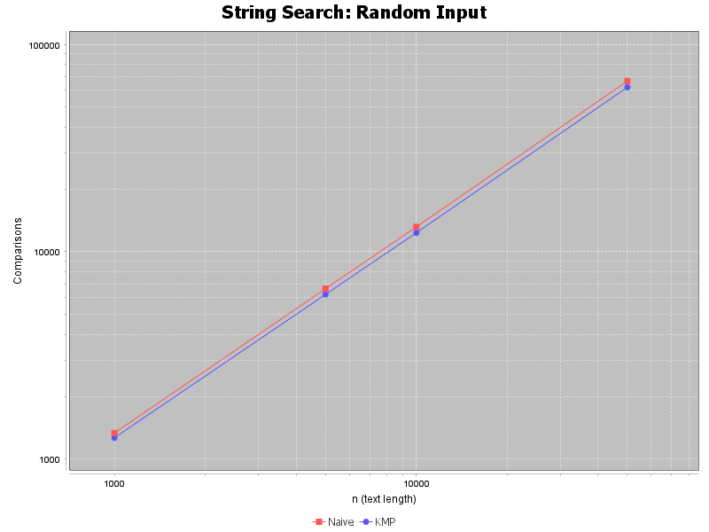

# DAA Assignment 4 - Experiment Report

**Author:** Bazaraly Ramazan
**Group:** SE-2526

## Experiment Design Card

*   **Question:** How much does dynamic programming (DP) speed up Edit Distance compared to recursion, and how much does KMP save in comparisons compared to Naive search on worst-case inputs?
*   **Sizes (n):**
    *   Edit Distance: 10, 20, 40, 80 (recursion can only survive up to n=15 due to O(3^n) complexity).
    *   Search: 1,000, 5,000, 10,000, 50,000.
*   **Inputs:**
    *   Edit Distance: Random strings over the alphabet [a-d].
    *   Search: Random text + random pattern (Average case); Text of 'A's + pattern of 'A's ending with 'B' (Worst case for Naive).
*   **Metrics:**
    *   Time (ms) - median of 3 runs.
    *   Operations counter (DP cells filled / char comparisons made).
*   **Prediction:**
    *   Recursion will be exponential and time out. DP will scale as O(n^2). Two rows will match the full table.
    *   KMP will be strictly O(N+M) on both random and worst cases. Naive will be fast on random, but will degrade to O(N*M) on the worst-case 'A'*N input.
*   **Plots:**
    1. Edit Distance operations vs n (log scale).
    2. Naive vs KMP operations on Worst Case (log scale).
    3. Naive vs KMP operations on Random inputs (log scale).

## Prediction vs Result

**Edit Distance:**
Prediction was correct. The recursive version made **783,818 operations** for n=10 alone and was 3 ms. For n=20, it became too slow to even run. The Table version made only **442 operations** for n=20 and scaled exactly as O(n^2). The Two Rows version made the exact same number of operations as the Table version (e.g., 1682 ops for n=40), proving that we saved O(n) memory without losing any computational speed.

**String Search:**
Prediction was partially correct. On **random inputs**, Naive and KMP made almost the same number of comparisons (e.g., for n=50,000: Naive = 66,561; KMP = 62,140). This is because random text rarely has long overlapping prefixes, so Naive finds mismatches instantly.
However, on the **worst-case input** ("AAAA..."), Naive exploded to **499,910 comparisons** for n=50,000 (which is exactly N*M). KMP stayed perfectly linear at **99,991 comparisons**. KMP successfully avoided backward moves.

## Short Answers

1. **Which input made your string search slowest, and why?**
   The worst-case input (a long text of 'A's and a pattern of 'A's ending in 'B') made the Naive search extremely slow. It took ~500,000 comparisons for n=50,000. This happens because Naive checks the pattern from the beginning every time it shifts by one position. Since the text is all 'A's, it matches almost to the very end every time, only to fail at the last character. It does not use previous match information.

2. **How large an n could the recursive Edit Distance handle, and what stopped it?**
   The recursive version could safely handle up to n=15 (around 783k operations taking 3 ms). When n was increased to 20, it did not finish in a reasonable time. What stopped it is the **exponential O(3^n) time complexity**. Pure recursion recomputes the same subproblems over and over again (overlapping subproblems). Without a memoization table, the call tree explodes.

3. **What do you gain and what do you lose when you use two rows instead of the full table?**
   You **gain memory efficiency**: the extra space drops from O(n*m) to O(m). For n=1000, the full table requires 1,000,000 integers (4 MB), while two rows only need 2,000 integers (8 KB). You **lose** the ability to reconstruct the actual sequence of edits (the path), because previous rows are overwritten. You also lose a tiny bit of time due to copying arrays, but the operations count stays exactly the same.

4. **If you had to choose one string search for your city platform, which one and why?**
   I would choose **KMP**. Even though Naive is slightly faster on average for completely random short words, a city platform (searching street names, log files) will inevitably contain repetitive data, typos, or long texts. KMP guarantees a strict O(N+M) worst-case time, meaning it will never lag or freeze the system, regardless of how bad the input is.

## One Paragraph on Time
Wall-clock times in the CSV show 0 ms for almost all search tests and DP tests, except for the recursive Edit Distance (3 ms). This is because modern CPUs execute 50,000 operations in less than a millisecond. Time measurements on small operations are dominated by JVM startup, JIT compilation, and OS scheduling noise. Therefore, the **operation counters** (cell updates and character comparisons) are the only reliable proof of the algorithmic complexity, which perfectly match the O(N*M) and O(N+M) theories.

## Plots

### Plot 1: Edit Distance Operations

*Takeaway: The full table and two-row versions have identical O(N*M) complexity, while the recursive version grows exponentially and crashes early.*

### Plot 2: Naive vs KMP on Worst-Case Input

*Takeaway: On worst-case inputs (repetitive text), Naive search performs O(N*M) comparisons, while KMP stays strictly linear at O(N+M).*

### Plot 3: Naive vs KMP on Random Input

*Takeaway: On random inputs, both algorithms perform similarly, proving that KMP's advantage is only visible when the input has repetitive patterns.*